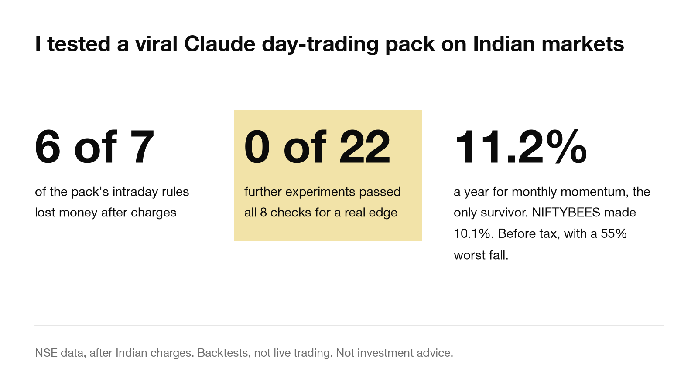
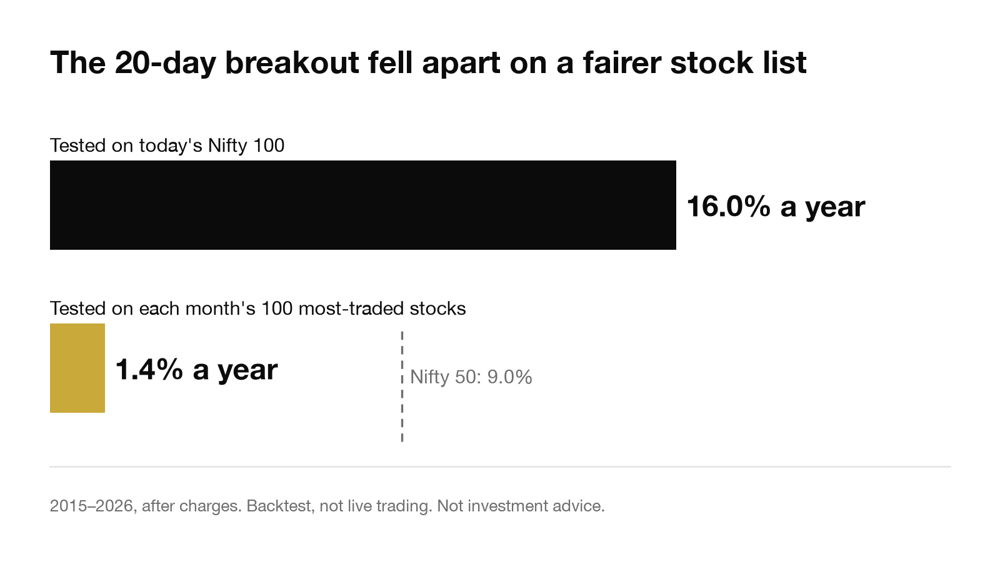

# India Trader Skill

Claude Code skills for researching, backtesting and paper-trading NSE stocks, with order support for Dhan and Angel One.

This began as an India port of Jake Schincariol's [day-trader-skill](https://github.com/Jakeschincariol/day-trader-skill). After porting it, I tested whether its strategies make money on Indian stocks after charges. Most did not. The code, experiment log and results are all here, so you can check them yourself.



## Results

All figures are backtests, not live trading. Full reports are in [`results/`](results/).

### The pack's intraday rules

I ran the 7 long-only rules on Nifty 50 stocks over 60 sessions (4 August to 29 October 2026). 6 lost money after charges. The seventh, an oversold bounce, averaged +0.10R on 119 trades, which is too thin to mean much. A filtered version then failed on a larger set of stocks.

This test used today's Nifty 50 list and a short window, so treat it as a first screen. See [`results/backtest/2026-10-29-nifty50-all.md`](results/backtest/2026-10-29-nifty50-all.md).

### 22 follow-up experiments

I then tested 18 stock ideas and 4 Nifty options ideas: shorting, mean reversion, lead-lag, time-of-day effects and market filters. Each had to pass 8 checks, including sample size, statistical significance, cost stress, breadth and benchmark comparison.

None passed all 8. The best score was 5 of 8. Six experiments averaged a profit in the validation window, but none held up across the checks. Only 5 of the 22 came from the pack's rules. The rest were new ideas.

Stock trades cost about Rs 26 per round trip on a Rs 25,000 position. Removing all charges would not fix this: 10 of the 18 stock experiments still made nothing, and the remainder could not be told apart from noise.

See [`results/research/report.md`](results/research/report.md).

### Multi-day strategies

Testing on today's index list hides the companies that fell out of it. To correct for this, I rebuilt each month's 100 most-traded stocks from NSE's daily files, including companies that later collapsed or merged. Results below cover 2015 to 2026, after charges.

| Strategy | Yearly return | Since 2022 | Worst fall |
| --- | --- | --- | --- |
| Monthly momentum rotation | 11.2% | 14.5% | 55.0% |
| 52-week high | 5.2% | 0.4% | 40.2% |
| Moving-average cross | 3.1% | 8.9% | 47.5% |
| 20-day breakout | 1.4% | -4.8% | 42.7% |
| Oversold bounce | 1.3% | 1.4% | 33.1% |
| Nifty 50 | 9.0% | | 38.4% |
| NIFTYBEES | 10.1% | | 36.3% |

Momentum is the only rule here that beat both benchmarks, and it is a rule that has been known for decades. On today's Nifty 100 list, the 20-day breakout appeared to return 16.0% a year.



On the 500 most-traded stocks, momentum returned 26.9% a year with a 52.6% worst fall. That result leans on smaller, less liquid stocks, so I trust it less. See [`results/backtest/`](results/backtest/) for all eight strategies.

### Limits of this work

- It covers Indian markets and this one pack. I did not test US stocks or other skill packs.
- Intraday tests use about 15 months of 5-minute data.
- The final locked test was never run, because nothing qualified for it.
- Besides the 97 logged parameter combinations, about 300 side looks were not logged in advance. They were counted afterwards, and the total of 396 is in the report.
- The earlier backtests had already touched the dates reserved for that locked test.
- The audit in [`AUDIT.md`](results/research/memos/AUDIT.md) was run by a separate AI agent. It reproduced 6 experiments and re-derived 19,885 trades with 0 mismatches.
- The swing results exclude dividends and tax. The swing engine is also not yet connected to the locked-test system.
- Intraday tests have no portfolio-level capital limit, so total rupee figures assume unlimited capital. Per-trade results are unaffected.

If you find a mistake, please open an issue.

## Skills

| Skill | What it does |
| --- | --- |
| `india-scanner` | Scans the Nifty 500 or all EQ stocks for breakouts, bull flags, oversold stocks and opening-range breaks. |
| `india-news` | Tracks NSE announcements, board meetings, corporate actions and headlines. |
| `india-entry` | Watches a stock bar by bar and reports when an entry triggers. |
| `india-exit` | Sets the stop and target on the correct tick, with charges included. |
| `india-timemachine` | Replays the rest of the session 10,000 times from the stock's recent history. |
| `india-budget` | Sizes a trade to your limits and writes one order. |
| `india-risk` | Passes or blocks an order against your rules. |
| `india-broker` | Sends approved orders to Dhan or Angel One, or to a local paper ledger by default. |
| `india-alerts` | Handles market hours, price alerts and stop, target and flat-by reminders. |
| `india-analyst` | Reads quarterly results from NSE XBRL filings. |
| `india-insiders` | Tracks insider disclosures and bulk and block deals. |
| `india-backtest` | Backtests intraday, options and multi-day strategies, and runs the momentum paper portfolio. |
| `india-research` | Runs a logged research process with locked data splits and statistical checks. |

`india-common` holds the shared code and must sit next to the skill folders.

## Install

You need Claude Code and Python 3. There is nothing to pip install.

```bash
git clone https://github.com/prakhar728/india-trader-skill.git
cd india-trader-skill
cp -R india-* ~/.claude/skills/
```

Run the skills from a working folder. They store their state in `trader/` inside that folder.

## Broker setup

You only need this for private market data or live orders. Paper mode is the default. Scanning, news and most backtests use free public data.

Copy `.env.example` to `.env` in your working folder and fill it in. Never commit that file. A variable already set in your shell takes priority.

Both brokers require a whitelisted static IP for order APIs under SEBI's retail algo rules.

**Dhan:** generate an access token at web.dhan.co under Access DhanHQ APIs. The token lasts 24 hours.

**Angel One:** create an app at smartapi.angelone.in, then add your API key, client code, PIN and TOTP secret. Angel One does not allow MARKET or IOC orders from algos, so the code refuses them.

Live trading needs three things: `"mode": "live"` in `trader/config.json`, the `--live` flag, and your typed approval of that exact order. Don't add the send command to Claude Code's allow-list.

## Reproducing the results

Check that the experiment log has not been altered:

```bash
python3 india-research/research.py --trader-dir results verify
```

Rebuild the multi-day results. This needs no account and downloads about 13 years of NSE daily files:

```bash
python3 india-backtest/backtest.py swing pit-fetch
python3 india-backtest/backtest.py swing pit-fetch --ca
python3 india-backtest/backtest.py swing pit-build
python3 india-backtest/backtest.py swing fetch
python3 india-backtest/backtest.py swing compare --universe pit100
```

The intraday research needs an Angel One account for 5-minute history. `india-common/prefetch.py` builds that dataset. Experiment code is in [`results/research/lab/`](results/research/lab/). The full market dataset is not included in this repo.

## Paper-trading momentum

`momentum_paper.py` runs the momentum rule forward on paper. It cannot reach a broker.

```bash
python3 india-backtest/momentum_paper.py init --capital 100000
python3 india-backtest/momentum_paper.py plan     # after the last session of the month
python3 india-backtest/momentum_paper.py fill     # at or after the next open
python3 india-backtest/momentum_paper.py status
```

Run `swing pit-fetch` and `swing pit-build` before `plan`, once that day's NSE file is out.

## Tests

```bash
python3 -m unittest discover -s tests
```

The tests run offline. Fixtures include small excerpts of public NSE and Yahoo data. API keys and account values in the tests are fake.

## Disclaimer

This is research software, not investment advice. I am not a SEBI-registered adviser. Trading can lose money, and backtests do not predict future results. Charges and rules change, so check them before relying on any figure here.

## Credits and license

MIT. See [LICENSE](LICENSE). Based on [day-trader-skill](https://github.com/Jakeschincariol/day-trader-skill) by Jake Schincariol.
